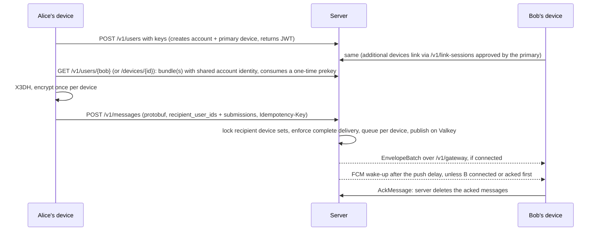

# Architecture

Endpoint details are in [openapi.yaml](../openapi.yaml); WebSocket frame semantics are in the [transport contract](https://github.com/obscura-messaging/obscura-proto/blob/main/TRANSPORT.md).

## Message flow

## Components

| Component | Code | Role |
|---|---|---|
| REST API | `src/api` | Accounts (`/v1/account/reset`), devices, link sessions (`/v1/link-sessions`), keys, sending, attachments, push tokens. `/openapi.yaml` serves the spec. |
| Gateway | `src/services/gateway` | One WebSocket per device, opened with a single-use ticket. Pumps queued messages in batches and batches acks into deletes. |
| Management | port 9090 | `/livez`; `/readyz` checks Postgres, the storage bucket and Valkey. |
| PostgreSQL | `migrations/` | Users (with account identity), devices, link sessions, keys, message queue, attachment metadata, push tokens, refresh tokens. |
| Valkey/Redis | `src/adapters/redis` | Cross-node pub/sub (channel per device), push job queue, idempotency cache, WebSocket tickets. Nodes are otherwise stateless. |
| S3 | `src/adapters/storage` | Encrypted attachments (`attachments/`, expire after `--ttl-days`). |
| FCM | `src/adapters/push` | Content-free wake-up (Android and APNs via FCM, collapse key `obscura_check`). Without FCM config, pushes are only logged. |

## Background workers

| Worker | Does |
|---|---|
| Message cleanup | Deletes expired messages, then the oldest beyond `--messaging-inbox-max-size` per device. |
| Attachment cleanup | Deletes expired attachments from S3 and Postgres. |
| Refresh-token cleanup | Deletes expired refresh tokens and expired link sessions. |
| Notification | Receives pub/sub events for local sockets; reclaims idle per-device channels. |
| Push notification | Leases due jobs from Valkey, sends them to FCM, deletes tokens FCM reports as invalid. |

A worker that exits outside shutdown stops the server.
